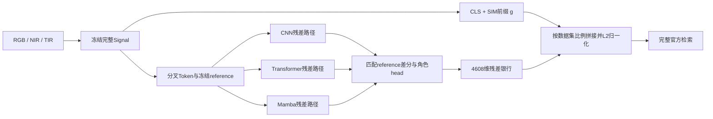

# 当前R2方法、来源与证据

2026-10-14，§41.980。本文对应正在交付的作者完整Signal初始化轨道，取代历史METHOD_SPEC_V1作为当前结果的资源与选模说明。RGBNT100 seed43仍在训练；当前不能宣布三数据集全部达标。本文是源码与现有结果核查，不是新的独立同行评审或完整查新结论。

## 实际网络与baseline

三个数据集的R2都调用[同一个V8 builder](../modeling/trifusion/signal_preserving_v8_builder.py)。完整Signal冻结，保留其CLIP CLS与SIM输出作为3072维前缀。SIM及Signal预训练知识属于借用部分；AlignM训练辅助头未作为新增模块重新训练。另行报告去掉SIM/AlignM的1536维PlainBaseline，不能把它与完整Signal混称同一个baseline。作者模型与权重来源见[Signal仓库](https://github.com/010129/Signal)，实际加载绑定见[official_three_dataset_model.py](../tools/official_three_dataset_model.py)。

在CLIP索引8的block输出处分叉，三个角色分别经过共享且冻结的三段CLIP尾块与各自可训练残差级。CNN级使用局部高频差分、深度卷积及门控；Transformer级使用窄瓶颈全局注意力；Mamba级使用四方向空间扫描，再按对应空间位置对长度3的模态序列做共享正反扫描。每条路径终点都减去同一次冻结Signal前向的尾部reference。CNN读取差分patch的水平分块，Transformer读取差分CLS，Mamba读取差分patch均值。它们是处理全部模态的三个角色，不能写成RGB/NIR/TIR各分配一个专家。[实际网络与读出](../modeling/trifusion/signal_preserving_v8.py)，[CNN/Transformer残差级](../modeling/trifusion/experts/semantic_residual.py)，[通用Mamba核的调用及四方向组织](../modeling/trifusion/experts/mamba.py)。

每个角色输出3×512维，三角色拼为4608维残差银行。当前使用固定拼接，Router/HFER未进入这条方法。完整检索维度7680。共享配置为semantic768、adapter128、feature512、三段尾块、scale_init=.05；201输入网格16×8，两个车辆集8×16。类别数、camera表大小与图像几何由数据集决定。只有最后的残差幅度比例用于已接近Signal的车辆集适配。[三数据集源码与实际Plain权重审计](../refine-logs/current_module_contract_20261014_973/AUDIT.json)。

## 借鉴与针对实际问题的改造

| 开源机制 | 已核查来源 | 当前方法的实际区别 |
|---|---|---|
| Signal语义/交互特征 | [作者仓库](https://github.com/010129/Signal) | 冻结完整Signal并提供匹配reference；新增的是其旁路角色残差，不把SIM改名为自己的发明。 |
| Mamba序列核；MambaPro聚合 | [通用核](https://github.com/state-spaces/mamba)、[MambaPro固定SSM源码](https://github.com/924973292/MambaPro/blob/f9ee6f60e58f21f3da1c8fd0e659fcc8db9ab149/modeling/fusion_part/mamba.py)、[AAM读出](https://github.com/924973292/MambaPro/blob/f9ee6f60e58f21f3da1c8fd0e659fcc8db9ab149/modeling/fusion_part/AAM.py) | 通用Mamba核是已有实现。MambaPro将三模态patch连成3N序列，并读CLS+聚合patch；当前在尾部残差级按位置扫描长度3的模态序列，再与冻结reference做差，保留三角色银行。结构区别不等于已证明更优。 |
| Smooth-AP可微排序 | [作者loss，59927ec](https://github.com/Andrew-Brown1/Smooth_AP/blob/59927ec4c59565bff209301d2c2b449ed1937806/src/Smooth_AP_loss.py) | 原代码按batch内身份组形成正例；当前按官方关系定义正例、忽略项及有效anchor，允许当前+历史候选。平滑排序公式不是原创；合法关系与支持处理是针对本任务的适配。 |
| XBM历史候选 | [作者trainer，223ecdc](https://github.com/msight-tech/research-xbm/blob/223ecdc25f71ef1721a58bc87cc567025a32bc92/ret_benchmark/engine/trainer.py) | 原实现将历史feature detach入队。当前保存匹配anchor/reference及RNG条件，用当前角色参数刷新表示，并补回历史候选VJP；不是把旧embedding队列直接移植进来。 |
| 梯度调制的相关工作 | [OGM-GE作者main，43aa733](https://github.com/GeWu-Lab/OGM-GE_CVPR2022/blob/43aa7332e1dbb2fc84a0c5e5c36a19f710eba085/main.py) | 这是本次相关源码对照，不能倒填为原开发供体。OGM-GE按模态分类置信贡献调制并可加噪声；R2在每个角色内平衡ranking与auxiliary梯度，且只在合法关系有支持时更新状态，未使用该置信系数/加噪配方。 |

这些源码区别支持“为当前问题编写的组合与改造”，不证明每个构件原创，也不构成穷尽性新颖性证明。本文没有运行、移植或更换上述作者模型，没有为正在训练的RGBNT100增加新模块。

## R2训练规则与问题证据

当前[train_r2](../tools/train_official_three_dataset_roles.py)使用batch64、每身份8条、AdamW lr=.00035/weight_decay=.0001、50epoch、5epoch LR warmup；前65次更新保持原hard triplet，再启用跨环境Smooth-AP。新鲜历史容量512、最大age8，当前anchor作查询，历史作候选，历史导数按原采样/RNG分组回放。M0与完整训练分别从登记初始化开始。该排序目标与支持平衡是训练规则，不能描述成新增加的推理网络层。

正例为同身份不同camera（MSVR为scene）；同身份同环境忽略；不同身份同环境仍为合法负例。[实际目标](../tools/msvr_cross_scene_smooth_ap.py)。真实早期source回放的fold0存在9744次全局无合法跨scene正例的anchor exposure，以及2个整batch无合法anchor；这支持排除无支持anchor并保持该步EMA状态，而不是处理假想情况。该数字只属于原source回放，不能冒充当前全量训练分布。[原支持统计](../evidence/smooth_ap_cross_scene_support_20260909/smooth_ap_cross_scene_support_20260909.json)。

每角色的ranking梯度含当前与历史项，auxiliary用直接求导。合法rank支持存在时，分别更新两种梯度范数EMA（decay=.9），计算 `q=clip(sqrt((EMA_aux+1e-12)/(EMA_rank+1e-12)), .25, 4)`，权重为 `w_rank=2q/(1+q)` 与 `w_aux=2/(1+q)`。无支持时保持原梯度组合和EMA；head梯度不由该规则重配。[实际平衡实现](../tools/msvr_supported_gradient_balance.py)。

历史配对R2研究中，balanced相对control只增加约.0533mAP，存在warmup数值轨迹差异，不能称为已严格隔离且普遍显著的平衡收益。[R2配对研究结论](../results/MSVR310_SUPPORTED_GRADIENT_BALANCE_R2_Q1_2026-09-21.md)。本次冷核验确认，完整201同Signal初始化、同额外50epoch的SIGNAL_V8完整E19端点为83.215406/86.961722/92.703349/94.976077，R2 E12为83.428396/87.679426/92.703349/94.497608。R2变化为mAP+.212989、R1+.717703、R5持平、R10−.478469个百分点；不能说全面胜过这个同预算对照。该差属于整个R2配方的比较，不是单独平衡规则的因果归因。[完整50轮与实存权重核验](../refine-logs/current_method_source_20261014_980/MATCHED201_REFERENCE.json)。

## 车辆幅度适配与实际评估

令g为完整Signal前缀，r为单位残差银行。推理使用 `f(rho)=normalize([g, rho*norm(g)*r])`，维度和模块不变。原rho=1让两块各占一半能量；rho=.25让残差块占1/17，rho=.75占.36。[唯一幅度变换](../modeling/trifusion/residual_budget.py)。这是一项数据集参数适配，不是新训练模块或独立创新点。

MSVR seed43/E19原rho1达到54.0082mAP，但Rank-1低于Signal8个净hits；保存距离诊断为repair28/harm36。固定原网格[.25,.5,.75]中，.25的完整实际端点为repair10/harm7，净增加3hits，四指标通过。这描述取得收益与丢失原修复之间的权衡，不能声称保留了全部原修复。[原端点及失败诊断](../refine-logs/seed43_msvr_terminal_20261014_975/REPORT.md)，[全部网格候选](../refine-logs/seed43_msvr_budget_grid_20261014_976/SUMMARY.json)，[实际独立复核](../refine-logs/seed43_msvr_qualified_20261014_979/COLD_VERIFIED.json)。

缓存平方距离插值只用于选择固定网格候选。原实际检查要求缓存mAP在1e-5内一致，因query446第三个正例33→32而失败。该一次排序变化解释全部+.000160231759mAP差异。旧FAILED及其条件保留；随后提前公开修正评估标准，保存实际float32距离并由本地/原作者评分一致确认，再用独立CPU进程重新加载全591查询重评分。这个端点累计实际编码2次，不能隐藏第一次失败或将新记录写成旧检查通过。[诊断与标准修正登记](../refine-logs/seed43_msvr_gold_20261014_978/REPORT.md)，[完整端点绑定](../refine-logs/seed43_msvr_qualified_20261014_979/ENDPOINT.json)。

## 当前完整端点与允许的结论

| 数据集 | 单一完整端点 | mAP / R1 / R5 / R10 | 相对完整Signal |
|---|---|---|---|
| RGBNT201 | seed42/E12/rho1 | 83.428396 / 87.679426 / 92.703349 / 94.497608 | 四项超过 |
| RGBNT100 | seed42/E7/rho.75 | 87.054805 / 97.551020 / 97.900875 / 98.192420 | R1持平；seed43待完成 |
| MSVR310 | seed43/E19/rho.25 | 54.547818 / 72.927242 / 83.587140 / 87.478849 | 四项超过 |

去模块PlainBaseline的三集mAP分别69.641503、83.704165、50.521979。其公开CLIP起点、seed1234和固定最终epoch，与当前完整Signal作者权重+额外角色训练不同。不能把全部相对Plain的提升称为新增模块的净因果收益。当前选择消耗了官方benchmark，并按用户要求在接近后选择整seed/整epoch/单一比例；不取seed均值、不混合各指标最优epoch，也不声明未见验证集上的无偏SOTA。

全目标仍未完成：RGBNT100需完整50epoch/首次正式评价，比较已尝试完整端点，若不达标需保存失败诊断，再按接近条件决定有限适配。原观察器7051在2026-10-15 15:01:42读取，未提前查询GPU0训练指标。当前选定网络与参数、已有对照的贡献边界、负结果和权重保留义务均已公开；进一步论文级模块因果或新颖性结论仍需其相应证据。

## 权重保留更新

2026-10-14 §41.981：当前MSVR seed43/E19角色best、作者Signal及实际距离继续保留服务器。旧seed42/E24角色best已完整复制到D盘并核对SHA后，清理服务器重复文件38,124,753字节；旧指标、距离、训练记录仍在服务器。旧端点有较高R5/R10，不能写成全指标被支配。重放旧seed42权重消费者前，需从精确D归档恢复原路径。[归档与恢复义务](../refine-logs/selected_msvr_weight_retention_20261014_981/RETENTION.json)。

## RGBNT100并行近值seed更新

2026-10-14 §41.983：原seed43/GPU0继续，依据完整seed42接近但未过的结果，仅补seed44/GPU1。同R2/ratio1/模块/训练配方/完整50；实际M0通过8更新、6支持步骤、无溢出/缺失梯度、冻结状态不变。预计44于10-15 21:06训练结束，单观察器64699在21:03近端读取；43的7051仍在15:01读取。两项估计均不等于成绩。闭合absolute958与random926的最佳权重已exactD核SHA后清理714,387,531B服务器重复件，重放旧消费者前精确恢复。[启动、M0与观察器记录](../refine-logs/rgbnt100_seed44_m0_20261014_983/REPORT.md)。

## RGBNT100近值失败的缓存margin补充

2026-10-14 §41.985：闭合seed42/E7的原固定ratio网格纯CPU诊断显示，rho.75的+.730599343缓存mAP中+.683437021（93.5447%）来自首位始终正确查询；首位修复与损伤仍7/7。由rho1缩至.75恰好保护q216/388，同时失去q133/161修复，净R1保持0。固定正负pair的银行margin可解释这些取舍，但pair交叉不是完整query阈值，未评分新ratio或证明连续幅度无解。缓存cnn/T/M输出均含Signal前缀，不能当纯角色贡献。全部旧分数重现、1715查询分组贡献及所有变动pair已保存；实际.75成绩不被缓存值替换。[完整诊断和执行记录](../refine-logs/rgbnt100_budget_margin_diagnosis_20261014_985/REPORT.md)。原43/44等待计划与方法模块不变。
